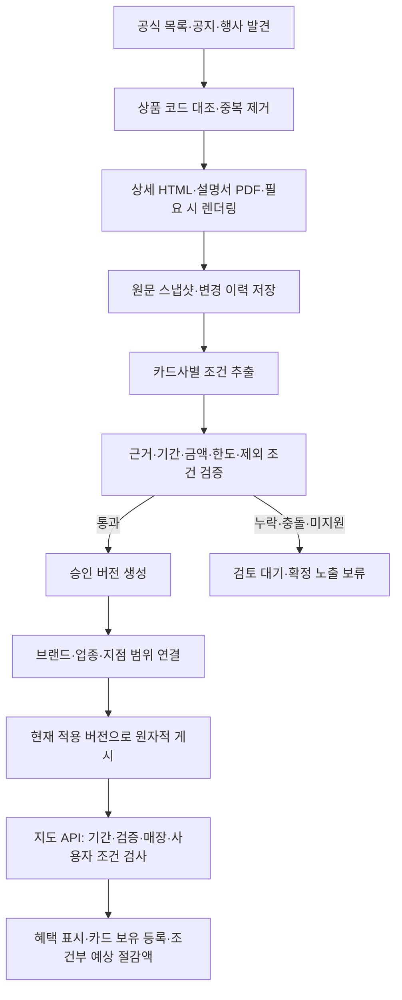

# 카드사 혜택 수집 파이프라인 설계

작성 기준: 2026-10-15. 이 문서는 현재 코드 확인 결과와 수집 대상·기간 조사에 기반한 목표 설계다. 신규 DB 스키마, 주기별 작업, 카드사별 수집기가 구현 완료됐다는 의미는 아니다.

후속 구현 현황: [출처·상품 발견·예약 수집](CARD_COLLECTION_RUNBOOK.md), [조건 추출](CARD_BENEFIT_EXTRACTION.md), [승인·지도 게시](CARD_PUBLICATION_RUNBOOK.md), [지도 보유 카드 등록](CARD_REGISTRATION_RUNBOOK.md), [관리자 검토·재검증](CARD_REVIEW_RUNBOOK.md)을 구현했다. [토스 첫 로컬 게시](CARD_TOSS_LOCAL_RELEASE.md)로 프로그램 1개를 매장 9곳에 연결했다. 아래 설계의 전체 정규화 스키마·전체 카드사 수집·주간 설명서 대조·시즌 후속 탐색·운영 배포까지 완료한 상태는 아니다.

참고: [수집 대상](CARD_ISSUER_COLLECTION_SCOPE.md), [8개 상품의 혜택 기간 조사](CARD_BENEFIT_REFRESH_PLAN.md), [현재 운영 파이프라인](MAP_PIPELINE_RUNBOOK.md).

구현 진행: 상품 후보·출처·원문·실행 이력 기반과 신한/BC 부분 목록 발견·예약 수집을 연결했다. 신한 공개 목록에서 신규 후보 24개를 실제 발견했다. 적용 결과와 실제 수집 제한, 실행 방법은 [카드 수집 운영 문서](CARD_COLLECTION_RUNBOOK.md)에 기록한다. 아래 목표 스키마 전체가 구현된 상태는 아니다.

## 1. 목적과 수집 단위

진행 추가: 토스 오프라인·신한 줍줍의 [조건 추출·검토 대기 버전 저장](CARD_BENEFIT_EXTRACTION.md)을 구현했다. 목표 스키마의 규칙/한도는 우선 버전 payload로 저장하며 승인·게시 계층은 아직 연결하지 않았다.

공식 상품 목록에서 카드를 발견하고 상세·설명서·변경 공지에서 혜택을 검증해 공용 DB에 적재한다. 지도는 이 DB를 조회한다. 사용자가 지도를 열거나 카드를 등록할 때 외부 카드사 사이트를 수집하지 않는다.

- 공간: 카드 상품과 브랜드 혜택은 전국 공통으로 한 번 수집한다. 지도 매장은 서비스 지역별로 확보하고 브랜드·업종·지점 조건으로 연결한다. 전국 모든 지점에 혜택 행을 복제하지 않는다.
- 시간: 상품 기본 혜택, 시즌 혜택, 개별 행사를 분리해 버전·기간을 관리한다. 발급사의 실제 변경 주기는 관측하고, 수집 주기는 운영 정책으로 정한다.
- 사용자: 매장 혜택에서 ‘이 카드 있어요’를 선택하면 보유 카드로 등록한다. 선택형 혜택팩·모드, 실적·잔여 한도 등 미확인 조건은 별도로 확인한다. 사용자의 카드 등록은 실제 결제·한도 검증을 뜻하지 않는다.
- 범주: 카드 할인·캐시백, 페이 행사, 학교 제휴를 분리한다. 이 문서는 카드 수집을 다루며 카카오페이·토스페이·삼성페이 자체 행사는 별도 출처를 쓴다. 중복 적용은 공식 근거가 있어야 한다.

초기 후보는 기존 10개 카드사·발급사의 30개 상품과 카카오뱅크·토스뱅크 출처의 8개 상품이다. 이는 검증용 시작 목록이며 공식 공개 개인 상품 목록 전체를 발견 대상으로 한다. 제휴 상품은 실제 발급사의 상품과 통합한다.

## 2. 전체 처리 흐름

각 단계는 재시도 가능한 작업으로 분리한다. 승인 전 원문·후보 데이터가 서비스 조회 테이블을 직접 덮어쓰지 않게 한다. 카드 전체의 파싱 성공 여부와 개별 혜택 성공 여부를 각각 남긴다.

## 3. 수집 및 갱신 주기

아래는 목표 운영 정책이다. 기존 5분 예약 작업을 ‘실행할 작업이 있는지 확인하는 틱’으로 활용하되 출처마다 `next_check_at`을 계산한다.

| 작업 | 기본 주기 | 처리 |
|---|---|---|
| 상품 목록·변경 공지·행사 목록 | 매일 1회 | 페이지네이션 완료 여부, 신규·변경 상품, 후속 시즌 발견 |
| 현재 승인 혜택의 상세 원문 | 매일 1회 | 본문 변경 확인·완전한 원문 재검증 |
| 기본 상품의 설명서·연결 문서 대조 | 주 1회 추가 | 상세 페이지와 수치·제외·정책 충돌 확인 |
| 월간 행사 점검 | 매월 1일 추가 | 일일 작업과 중복 요청 제거 |
| 종료 30일 전 | 일일 확인에 후속 탐색 추가 | 다음 시즌·연장 공지 확보 |
| 종료 7일 전 | 6시간마다 | 해당 출처만 우선 확인 |
| 조기 종료·예산 소진형 | 6시간마다 | 확인 시각 표시, 잔여 예산 보장 금지 |
| 재시도 | 실패별 백오프 | `Retry-After` 우선, 요청 간격·실패 횟수 기록 |
| 시작·만료 상태 정리 | 5분마다 | 외부 요청 없이 DB 상태·지도 갱신 버전 정리 |
| 실제 지도 노출 판정 | API 조회마다 | 시작 전·종료 후·검증 만료·철회 즉시 제외 |

발급사별 요청 동시성은 초기 1, 요청 간격은 초기 2초 이상을 출발점으로 설정하고 실제 출처 정책·오류율에 따라 더 느리게 조정한다. 이는 허용량을 확인했다는 뜻이 아니다. 동일 URL의 한 번 수집 결과를 여러 상품·혜택에서 재사용한다. 304로 파싱 검증 시각을 연장하지 않으며 재검증 기한에는 본문을 다시 확보한다.

검증 유효기간은 수집 간격과 별도다. 현재 KB 자동 승인의 7일을 기본 상품의 초기 상한으로 유지하고, 기간형 행사는 24시간, 조기 종료형은 6시간을 초기 제안값으로 둔다. 만료 시 확정 적용에서 제외한다. 실제 보장 가능한 검증 수준·장애율을 측정해 조정한다. 조건 변경을 이미 감지했다면 이 유예를 사용하지 않고 즉시 이전 승인을 보류한다.

KST 기준 날짜가 포함되는 종료일은 다음 날 00:00을 배타적 종료 시각으로 변환하고 DB 시각은 UTC로 저장한다. 공고에 시간이 명시되면 그 시간을 우선한다. 미래 시즌은 미리 저장하되 시작 시각 전에는 현재 혜택으로 게시하지 않는다. 기간을 추정해 연장하지 않는다.

## 4. 수집 DB 스키마

아래 테이블명과 필드는 제안이다. 공통으로 PK/FK·생성/수정 시각을 두고, 시각은 시간대가 있는 타입, 비율은 DECIMAL 또는 정수 bps, 원화 금액은 정수로 저장한다. 금액 계산에 Float를 사용하지 않는다.

### 4.1 출처·상품·원문

| 테이블 | 핵심 필드 | 역할·제약 |
|---|---|---|
| `card_issuers` | `id`, `issuer_key`, `name` | 실제 발급사. `issuer_key` UNIQUE |
| `card_collection_sources` | `id`, `issuer_id?`, `provider_key`, `source_kind`, `canonical_url`, `adapter_key`, `adapter_version`, `enabled`, `schedule_policy`, `next_check_at`, `last_attempt_at`, `last_success_at`, `last_full_fetch_at`, `etag`, `last_modified`, `failure_count`, `next_retry_at` | 공식 목록·상세·설명서·공지·행사 출처. 카카오뱅크 같은 유통 채널과 발급사 구분. URL은 검증 후 정규화하고 중복 방지 |
| `cards` 확장 | 기존 `id`, `card_key`, `card_name` + `issuer_id`, `product_type`, `product_version`, `issuance_state`, `issuance_effective_at`, `issuance_evidence_id`, `last_seen_at` | 기존 보유 카드 참조 ID 유지. 발급 종료와 혜택 종료 분리 |
| `card_product_sources` | `id`, `card_id`, `source_id`, `source_namespace`, `external_product_code`, `source_role`, `first_seen_at`, `last_seen_at` | 한 상품의 발급사·제휴 채널·설명서 연결. `(source_namespace, external_product_code)` UNIQUE. 코드 없는 상품은 검토된 URL 식별자를 사용하고 이름 유사도만으로 병합 금지 |
| `card_source_snapshots` | `id`, `source_id`, `fetched_at`, `http_status`, `raw_sha256`, `semantic_sha256`, `raw_object_ref`, `extracted_text`, `mime_type`, `parser_version`, `fetch_status`, `completeness` | 불변 원문 버전. HTML/PDF/렌더링 결과 보관. 같은 내용은 파일 재사용하되 확인 시각·실행 기록 보존 |

공식 도메인·리다이렉트·쿼리 파라미터를 어댑터별 허용 목록으로 제한한다. 임의 URL 접근은 허용하지 않는다. 공개 요청에 개인 카드번호·로그인 정보는 넣지 않는다. 원문은 비공개 저장소에 보관하고 실행 로그에 인증값을 남기지 않는다.

### 4.2 혜택·조건·검증

| 테이블 | 핵심 필드 | 역할·제약 |
|---|---|---|
| `card_benefit_programs` | `id`, `program_key`, `program_name` | 공유 혜택 프로그램의 안정적 식별자. 체크카드·K-패스 변형이 같은 프로그램을 공유 가능 |
| `card_program_products` | `program_id`, `card_id`, `applicability_rules` | 프로그램과 카드 M:N 연결. 복수 카드 보유로 같은 혜택이 중복 합산되지 않게 함 |
| `card_benefit_versions` | `id`, `program_id`, `version_no`, `benefit_kind`, `season_id`, `valid_from`, `valid_until_exclusive`, `period_status`, `eligibility_rules`, `rules_schema_version`, `review_state`, `validated_at`, `validation_expires_at`, `publication_state`, `supersedes_id` | 기본·시즌·행사 버전. `(program_id, version_no)` UNIQUE. 종료일 미표기와 추출 실패를 구분. 승인 버전 수정 대신 새 버전 생성 |
| `card_benefit_rules` | `id`, `version_id`, `rule_key`, `reward_method`, `calculation_type`, `rate_bps`, `amount_krw`, `payment_min_krw`, `payment_max_krw`, `tier_rules`, `selection_key`, `payment_channel_rules`, `exclusions`, `rounding_rule` | 한 버전의 브랜드/금액 구간별 혜택. 청구할인·현장할인·캐시백·포인트와 정률·정액·랜덤을 서로 다른 축으로 저장 |
| `card_benefit_limit_groups` | `id`, `version_id`, `group_key`, `scope`, `period`, `amount_cap_krw`, `count_cap`, `prior_spend_tiers`, `first_transaction_only` | 브랜드 간 공유 한도·영역별 횟수·월 통합 한도. `(version_id, group_key)` UNIQUE. 규칙과 M:N 연결 테이블 필요 |
| `card_benefit_scopes` | `id`, `rule_id`, `scope_type`, `brand_key?`, `category_code?`, `store_id?`, `include_or_exclude`, `channel`, `evidence_id` | 전국·브랜드·업종·특정 지점 및 제외 범위. 매장별 혜택 복제 방지 |
| `card_benefit_evidence` | `id`, `version_id`, `rule_id?`, `snapshot_id`, `field_path`, `quote`, `locator`, `evidence_type` | 수치·기간·제외·적용 범위 각각의 원문 근거. 페이지 번호/선택자/텍스트 위치와 스냅샷을 연결 |
| `card_validation_runs` | `id`, `version_id`, `validator_version`, `status`, `checks`, `missing_fields`, `conflicts`, `reviewer`, `reviewed_at` | 검증 결과 이력. 수집 성공과 승인 성공 구분 |

한도 그룹은 핵심이다. 예를 들어 토스의 음식·음료 영역 여러 브랜드가 같은 횟수 한도를 쓴다면 각 브랜드에 한도를 새로 부여하지 않는다. 전월 실적 구간별 한도도 카드 한 장의 고정 할인율로 축약하지 않는다. 랜덤 보상의 최소·최대는 `tier_rules`의 검증된 구조로 저장하고 확정 절감액 계산에서 제외한다.

기간형 행사에는 `card_campaign_windows(version_id, window_type, phase_key, starts_at, ends_at_exclusive, schedule_text, evidence_id)`를 둔다. 응모·실적 인정·지급·쿠폰 등록·쿠폰 사용 기간을 구분하고, ‘12월 말 이후’처럼 정확한 시각이 없는 지급 일정은 원문을 유지한다.

### 4.3 게시·실행·사용자

| 테이블 | 핵심 필드 | 역할 |
|---|---|---|
| `card_publications` | `id`, `version_id`, `publication_key`, `published_at`, `withdrawn_at`, `reason` | 승인된 특정 버전의 게시 이력. 게시와 기존 조회 모델 반영을 같은 트랜잭션으로 처리 |
| `card_collection_runs` | `id`, `trigger`, `started_at`, `finished_at`, `status`, `counts` | 통합 실행 기록 |
| `card_collection_tasks` | `id`, `run_id`, `source_id`, `task_kind`, `scheduled_for`, `status`, `lease_owner`, `lease_until`, `attempt`, `error_code`, `snapshot_id` | 작업별 재시도·중복 방지. `(source_id, task_kind, scheduled_for)` UNIQUE. 처리 중 잠금 갱신·소유자 확인 |
| 기존 사용자 카드 저장 모델 확장 | `user_id`, `card_id`, `ownership_source`, `registered_at` + 선택 이력의 `selection_key`, `effective_from`, `effective_until` | 직접 보유 등록과 API 확인 구분. The의 즉시 변경·토스의 적용 시점 차이 반영. 구매 내역·잔여 한도는 별도 정보이며 보유 등록으로 생성하지 않음 |

원문 파일을 DB에 매번 중복 저장하지 않고 객체 저장소/로컬 비공개 파일 참조를 사용한다. 목표 보관 정책은 원문·승인 근거 1년 이상, 실행 상세 90일을 초기안으로 두되 실제 저장량을 측정해 조정한다. 현재 게시 버전과 연결된 근거는 보관 기간이 지나도 삭제하지 않는다. 만료 혜택은 상태를 전환하고 감사 이력을 보존한다.

주요 인덱스는 출처 `(enabled, next_check_at)`, 작업 `(status, scheduled_for)`, 혜택 버전 `(publication_state, valid_from, valid_until_exclusive)`, 범위 `(brand_key, rule_id)`·`(store_id, rule_id)`, 근거 `(version_id, field_path)`다. 카드 상품 목록에서 한 번 사라진 것을 발급 종료로 판정하지 않는다. 목록 완전성·공식 종료 공지 확인이 필요하다.

## 5. 조건 스키마와 승인 기준

JSON 필드는 자유 문장이 아니라 버전이 있는 엄격한 스키마로 검증한다. 조건은 AND/OR, 최소 결제액, 전월 실적 구간, 신규 유예, 선택 모드, 결제 경로, 한도 그룹, 중복 적용 정책을 표현한다. 미지원 조건은 명시적으로 미지원 상태를 반환한다.

자동 승인 조건:

1. 공식 출처·상품 일치와 본문 완전성을 확인한다. 빈 렌더링, 차단 페이지, 로그인 화면을 성공으로 처리하지 않는다.
2. 할인/캐시백 방식·금액 구간·시작/종료일·한도·대상·제외·결제 경로의 필수 근거를 확보한다. 기본 상품의 종료일 미표기는 근거 있는 상태로 저장할 수 있지만 기간형 행사의 날짜 추출 실패와 혼동하지 않는다.
3. 요약·상세·설명서의 수치와 정책을 교차 검증한다. 다른 버전 문서가 섞이면 최신이라는 이유만으로 임의 선택하지 않고 적용 관계를 확인한다.
4. 정률/정액·구간 경계·한도·소수점 처리 계산을 검증한다. 랜덤·포인트의 가치를 근거 없이 원화 할인율로 환산하지 않는다.
5. 원문 레이아웃이나 미지원 조건이 바뀌면 검토 대기로 둔다. LLM은 후보 추출에 사용할 수 있지만 단독으로 승인하거나 누락 조건을 보완하지 않는다.
6. 관리자 철회는 자동 재승인하지 않는다. 게시 직전에 검증한 스냅샷·버전·기간이 여전히 일치하는지 확인한다.

검토 상태(`pending/approved/rejected/revoked`)와 게시 상태(`draft/scheduled/live/suspended/expired`)는 분리한다. 수집 실패도 별도 상태로 남긴다. 새 조건 변경을 감지하면 영향을 받는 기존 버전은 즉시 `suspended`로 바꾸고 승인 후 교체한다. 확인된 무관한 광고 변경은 정책 본문 지문과 분리하되 제외·기간 문구가 지문에서 빠지지 않게 한다.

## 6. 지도 반영과 사용자 적용

전국 공통 카드 혜택 → 브랜드/업종 범위 → 서비스 지역의 검증된 매장으로 연결한다. 업종 혜택은 지도 업종명만으로 확정하지 않는다. 발급사의 가맹점 업종 분류나 제외 점포 여부를 확인할 수 없으면 조건부로 안내한다.

지도 API는 승인 버전·기간·검증 유효성·철회 여부·위치 검증을 먼저 검사하고 사용자 보유·선택팩·실적·결제 방식·잔여 한도를 판정한다. 응답에는 `benefit_version_id`, `eligibility_status`, `unmet_conditions`, `unknown_conditions`, `estimated_reward`, `source_url`, `verified_at`, `valid_until`을 포함한다. 예상액 계산은 결제 예정액이 있고 계산 조건이 확보된 경우만 수행한다. 미확인 실적·한도는 0이나 충족으로 기본 처리하지 않는다.

혜택 조회 화면은 카드/페이/학교 제휴를 구분하고 카드 등록을 제공한다. 중복 적용 정책이 미확인이면 각각을 비교해서 보여주되 합산 절감액을 만들지 않는다. 신규 발급 보너스·교통 환급·온라인 전용 혜택은 현재 오프라인 매장 할인에 합치지 않는다.

## 7. 현재 코드와 차이

| 항목 | 현재 확인한 구현 | 추가 작업 |
|---|---|---|
| 예약 실행 | `map_sync` 300초, 실행 잠금·재시도 | 출처별 다음 실행 시각, 작업 큐·발급사 요청 제한 |
| 상품 발견 | DB에 있는 펭수 카드 혜택을 출처에 연결 | 목록 페이지네이션·신규 상품 생성·제휴 중복 제거 |
| 지원 범위 | KB 펭수의 4개 브랜드 혜택 자동 추출·검증 | 카드사별 목록/상세/설명서/공지 어댑터 |
| 출처 검증 | 제한된 공식 도메인·쿼리 허용 목록 | 카카오뱅크·토스뱅크 및 추가 카드사 공식 호스트·쿼리를 어댑터별 검토 후 등록 |
| DB | `cards`, `card_benefits`, `map_source_states`, `map_evidence`, `map_review_events`, `map_job_leases` | 상품 원천 식별자·스냅샷·혜택 버전·공유 한도·작업 테이블 |
| 기간 | 날짜형 `valid_from/valid_to`, `PeriodType`에 특정 월/주차 문자열 존재 | 시간 경계·기간 상태·시즌·행사 차수 분리. 기존 특정 월/주차 enum을 갱신 주기로 재사용 금지 |
| 금액 | `value_min/value_max` Float, 캐시백이 `BenefitType`의 한 값 | 보상 방식과 계산 방식 분리, 정수 원화·bps 계산 |
| 검증·게시 | `MapEvidence` 최신 상태와 원문 변경/리뷰 이벤트, 승인 공통 가드 | 불변 버전별 근거·검증, 예약 게시·중지·원자적 교체 |
| 지도 연결 | 브랜드 단위 `CardBenefit`, 위치 검증 별도 | 업종·지점 제외 및 공유 한도/프로그램 판정 강화 |

현재 모델·서비스: `app/models/card.py`, `app/models/map_source.py`, `app/models/map_verification.py`, `app/services/map_sync.py`, `app/services/map_card_pipeline.py`.

`CardBenefit`은 초기에는 기존 API용 조회 모델로 유지하고 새 승인 버전에서 투영한다. `canonical_rule_id`·`published_version_id`와 매핑 테이블을 두어 카드×브랜드 행과 다중 범위 규칙을 연결한다. 기존 텍스트·기간이 들어간 `dedup_key`는 안정적 혜택 ID로 사용하지 않는다. 새 계산 결과를 기존 Float 값으로 다시 계산하지 않는다.

이전 데이터는 출처·기간·검증 근거가 확인된 것부터 전환하고 미검증/예시 데이터는 승인 상태를 승계하지 않는다. `StoreOffer`의 매장×페이 단일 행 구조는 별도 페이 고도화 대상이며 새 카드 혜택 버전을 거기에 덮어쓰지 않는다.

## 8. 구현 순서와 완료 기준

1. **출처·상품·원문 기반:** 신규 스키마와 마이그레이션, 허용 출처 등록, 불변 스냅샷 저장. 기존 카드/사용자 참조 ID 보존, 같은 상품의 반복 수집에서 중복 0건.
2. **최초 목록 어댑터:** 현재 KB 상세 수집을 유지하면서 목록 발견을 추가하고, 카카오뱅크·토스뱅크 8개 후보로 선택형·시즌형을 검증. 프렌즈 추가 혜택 공개 상세 렌더링 실패는 미확인으로 계상. 목록 페이지 완료율과 후보 발견 수 실측.
3. **조건·버전 검증:** 시즌·날짜·보상·공유 한도·제외 근거와 독립 계산 검증. 미지원/충돌 시 확정 게시 0건, 랜덤 최대액의 확정 표시 0건.
4. **주기·만료 처리:** 일일/주간/종료 임박 큐와 재시도·잠금 연결. KST 자정, 미래 시즌, 장애, 중복 실행, 기간 연장 미확인 시나리오 검증.
5. **지도·등록 연결:** 승인 버전만 기존 조회 모델에 반영하고 보유 등록·선택팩 흐름 연결. 한도 미확인을 충족으로 처리하는 경우 0건.
6. **카드사 확대·운영 측정:** 나머지 초기 후보와 공개 목록 전체로 확대. 로컬 검증 후 운영 배포·예약 실행을 별도로 확인. 현재 실행 환경의 5분 틱 관측과 전체 카드사 수집 완료를 혼동하지 않음.

지표는 발견 상품 수·목록 완전성·원문 확보율·필수 필드 근거 확보율·검증 통과율·미지원 수·검토 대기 수·승인 혜택 수·지도 연결 수·재검증 지연·만료 노출 건수로 나눈다. 실패한 상품도 분모에 포함한다. 알려진 정답 표본의 필드 정확도와 전체 상품 처리 커버리지를 따로 측정하며 단순 수집 성공률을 혜택 정확도로 보고하지 않는다.

우선 운영 목표는 지원 대상의 일일 확인 지연 24시간 이내, 종료 임박 대상 6시간 이내, 만료 혜택 API 노출 0건이다. 발급사 접근 장애 시 달성 실패를 기록하고 검증 유효기간에 따라 노출을 제한한다. 운영 상태는 기존 관리자 health·queue·history에 출처/단계/지연 지표를 연결한다. 외부 알림 채널 연동은 별도 설정 작업으로 둔다.
